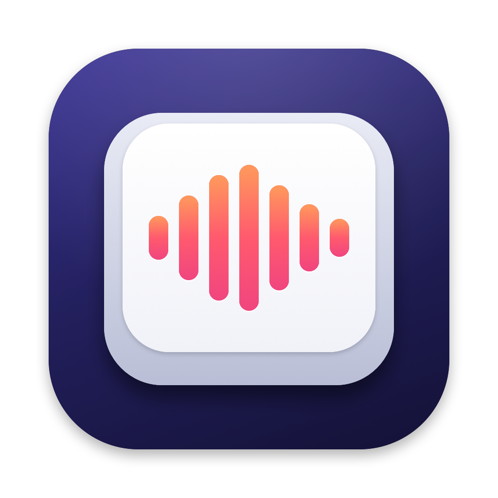

<p align="center"></p>

# Koeboard

キーを押しながら話すと、どのアプリにも文字が入る音声入力ツールです。Windows・macOS・Linux で動き、日本語に強くしています。文字起こしはパソコンの中だけで行うので、声は外に出ず、料金もかかりません。

Koeboard は [Handy](https://github.com/cjpais/handy)（MIT ライセンス）をもとにしています。

[English below](#english)

## Handy に足したもの

- 日本語専用の音声認識モデル「Parakeet TDT-CTC 0.6B 日本語」（[NVIDIA](https://huggingface.co/nvidia/parakeet-tdt_ctc-0.6b-ja) のモデルを Handy の形式に変換）。最初のおすすめにしています
- 「えーと」「あのー」などの日本語のつなぎ言葉を取り除く
- Koeboard の名前・アイコン・色

## 使い方

1. [リリース](https://github.com/ASRISE/koeboard/releases)からダウンロードしてインストールする（準備中）
2. 初めて開くと、マイクなどの許可とモデルのダウンロードを案内します
3. 録音キーを押しながら話して、離すと、カーソルの位置に文字が入ります

## 開発

[Rust](https://rustup.rs/) と [Bun](https://bun.sh/) が要ります。詳しくは [BUILD.md](BUILD.md) を見てください。

```sh
bun install
mkdir -p src-tauri/resources/models
curl -L -o src-tauri/resources/models/silero-vad-v6.2-F32.gguf https://huggingface.co/handy-computer/silero-vad-v6.2-gguf/resolve/main/silero-vad-v6.2-F32.gguf
CMAKE_POLICY_VERSION_MINIMUM=3.5 bun run tauri dev
```

Koeboard だけの変更は、なるべく Handy の更新を取り込みやすい形にしています。

- Koeboard が公開するモデルは `src-tauri/src/catalog/koeboard_catalog.json` に書き、Handy の `catalog.json` はそのまま残す
- アイコンを作るスクリプトは `scripts/koeboard/`
- 日本語 Parakeet の変換に使った transcribe.cpp の変更は `scripts/koeboard/0001-*.patch`

Handy の更新を取り込むとき:

```sh
git remote add upstream https://github.com/cjpais/handy.git
git fetch upstream
git merge upstream/main
```

## ライセンス

MIT ライセンスです（[LICENSE](LICENSE)）。Handy の著作権表示はそのまま残しています。「Handy」の名前・ロゴ・アイコンは Handy のもので、Koeboard では使っていません。日本語 Parakeet のモデルは NVIDIA のモデルを変換したもので、CC-BY-4.0 です。

---

## English

Koeboard is push-to-talk voice typing for Windows, macOS and Linux, tuned for Japanese. Speech is transcribed on your computer — nothing is uploaded. It is a fork of [Handy](https://github.com/cjpais/handy) (MIT).

What Koeboard adds on top of Handy:

- A Japanese speech model, Parakeet TDT-CTC 0.6B Japanese, converted from [nvidia/parakeet-tdt_ctc-0.6b-ja](https://huggingface.co/nvidia/parakeet-tdt_ctc-0.6b-ja), recommended by default
- Japanese filler-word removal (えーと, あのー, …)
- Koeboard name, icons and colors

License: MIT. The Handy name, logo and icon belong to the Handy project and are not used here.
